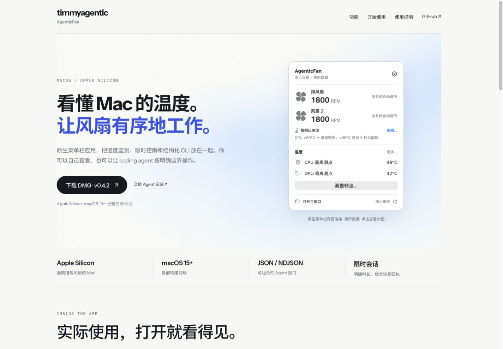
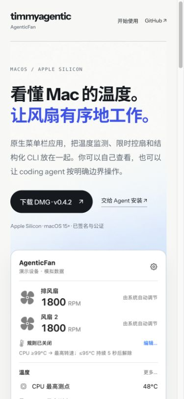

# Website polish QA — 2026-10-25

The homepage links directly to the published signed/notarized v0.4.2 DMG and shows native SwiftUI interface renders using demonstration data. Installation text and the single portfolio footer work on mobile.

Validated in a local browser at 1440 × 1000 and 390 × 844; the page also has no horizontal overflow at 320 px. Visible images loaded. Social metadata resolves to a 1200 × 630 image. Screenshots below are unmodified browser captures of the candidate.

Checks passed: `python3 -m unittest discover -v`, JavaScript syntax, whitespace and Wrangler dry run. Repository policy is checked against the committed PR.

This is website acceptance. Live installation, authentication, production hardware/network operations, and native client acceptance are outside this change. A successful local check does not prove production deployment; the reviewed commit must be deployed and read back separately.

